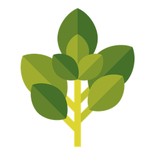
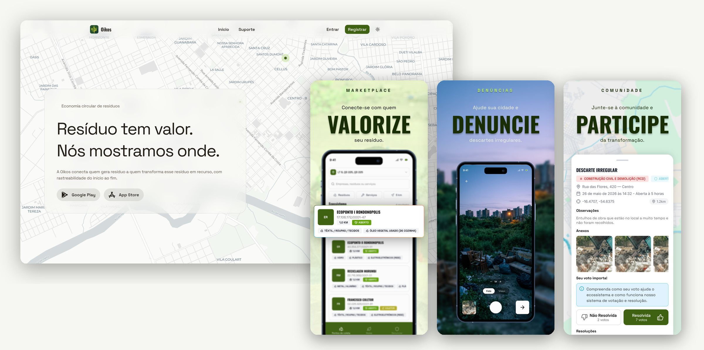
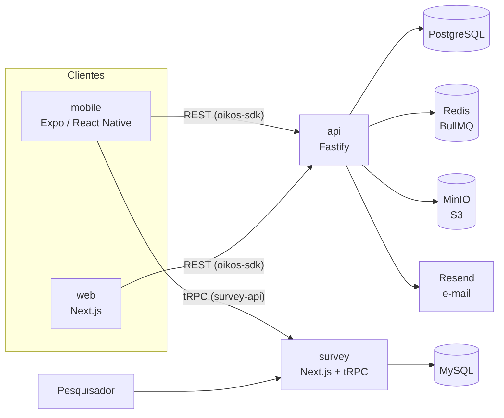

<p align="center">
  
</p>

<h1 align="center">Oikos API</h1>

<p align="center">
  <a href="https://github.com/oikos-circular-environment/api/actions/workflows/ci.yml"></a>
  
  
  
  
</p>

<p align="center">
  <strong>Backend da plataforma Oikos de economia circular de resíduos.<br>
  Regras de negócio, autenticação, filas e armazenamento que atendem o app e o painel web.</strong>
</p>

<p align="center">
  <picture>
    <source media="(prefers-color-scheme: dark)" srcset=".github/assets/api-hero-dark.jpg">
    
  </picture>
</p>

<p align="center">
  <a href="https://oikos.company">Site</a> ·
  <a href="https://apps.apple.com/br/app/oikos-economia-circular/id6786017565">App Store</a> ·
  <a href="https://play.google.com/store/apps/details?id=com.oikos">Google Play</a>
</p>

## Sobre o Oikos

O Oikos é uma plataforma de economia circular de resíduos sólidos. Ela conecta quem gera resíduo (moradores, empresas e órgãos públicos) a quem transforma esse resíduo em recurso: cooperativas, recicladoras, ecopontos e coletores.

O produto tem três frentes:

- **Pontos de coleta e mercado.** Mapa de empresas e ecopontos com os resíduos que cada um aceita, horários de funcionamento e preço pago por quilo.
- **Denúncias ambientais.** Registro de descarte irregular com foto, vídeo e localização. A comunidade vota se a denúncia foi resolvida e a moderação acompanha o andamento.
- **Modo pesquisa.** Teste de usabilidade aplicado dentro do próprio aplicativo, usado na avaliação da dissertação de mestrado que originou o projeto.

## Ecossistema

| Repositório | Papel | Stack principal |
|---|---|---|
| **api** (este) | API REST, regras de negócio, autenticação, filas e armazenamento | Fastify, Prisma, PostgreSQL, Redis, MinIO |
| [web](https://github.com/oikos-circular-environment/web) | Site institucional e painel web para organizações e moderação | Next.js, Tailwind CSS, MapLibre |
| [mobile](https://github.com/oikos-circular-environment/mobile) | Aplicativo iOS e Android | Expo, React Native |
| [survey](https://github.com/oikos-circular-environment/survey) | Instrumento e painel do teste de usabilidade | Next.js, tRPC, Drizzle, MySQL |
| devops (privado) | Infraestrutura, deploy e observabilidade | Terraform, Docker Compose, Nginx, Grafana |

## Arquitetura



A API expõe uma especificação OpenAPI. A partir dela é gerado o pacote `@oikos-circular-environment/oikos-sdk` (pasta `packages/oikos-sdk`), que o app e o painel web consomem. Assim os dois clientes usam os mesmos tipos e rotas da API.

## Stack

| Área | Tecnologia |
|---|---|
| Servidor HTTP | Fastify 5 com validação Zod (`fastify-type-provider-zod`) |
| Banco de dados | PostgreSQL com Prisma 7 |
| Autenticação | Better Auth com e-mail e senha |
| Filas e jobs | BullMQ sobre Redis (quórum de denúncias, exclusão de conta) |
| Arquivos | MinIO (compatível com S3) ou Supabase Storage |
| E-mail | Resend com templates em React Email |
| Documentação | OpenAPI com Scalar em `/docs` |
| Observabilidade | OpenTelemetry (traces, métricas e logs com Pino) |
| Testes | Vitest (unitários, integração e e2e) |
| Qualidade | Biome e Lefthook |

## Estrutura

```
src/
  modules/        domínios da aplicação
    accounts      cadastro, senha e exclusão de conta
    auth          autenticação e sessões
    companies     empresas, cooperativas e ecopontos
    complaints    denúncias ambientais, votos e resoluções
    denunciation  denúncias enviadas à equipe, com foto e vídeo
    market        mercado de resíduos e preços
    moderation    moderação de conteúdo
    profiles      dados, endereço e foto do usuário
    storage       upload e entrega de arquivos
    support       chamados de suporte com anexos
    wastes        catálogo de resíduos
    common        provedores compartilhados (e-mail, storage, filas)
prisma/           schema, migrations e seeds
cli/              geração de seeds de empresas por cidade
packages/oikos-sdk  SDK gerado a partir do OpenAPI
docs/             regras de negócio e documentação técnica
```

## Rodando localmente

Pré-requisitos: Node.js 24 e Docker.

```bash
cp .env.example .env
npm install

docker compose -f docker-compose.dev.yml up -d postgresql redis minio createbuckets

npm run migrate:dev
npm run seed
npm run dev
```

A API sobe em `http://localhost:3333` e a documentação interativa fica em `http://localhost:3333/docs`.

Para subir tudo em containers, inclusive a própria API, use `npm run dev:up`.

### Serviços locais

| Serviço | Porta | Usuário | Senha |
|---|---|---|---|
| PostgreSQL | `5432` | `oikos` | `oikos_dev` |
| Redis | `6379` | sem usuário | sem senha |
| MinIO (API) | `9000` | `oikos` | `oikos_dev` |
| MinIO (console) | `9001` | `oikos` | `oikos_dev` |

O PostgreSQL de desenvolvimento não tem volume persistente. A cada `down` e `up` o banco é recriado e as migrations são reaplicadas.

## Testes

```bash
npm test                  # unitários
npm run test:infra:up     # sobe Postgres, Redis e MinIO isolados para os testes
npm run test:integration  # integração
npm run test:e2e          # ponta a ponta sobre a API real
```

## Colaboração

Contribuições são bem-vindas. O fluxo é o mesmo em todos os repositórios do Oikos:

1. **Comece por uma issue.** Descreva o problema ou a proposta antes de abrir código.
2. **Crie a branch a partir de `development`**, com o nome `<número-da-issue>-<descrição-curta>`, por exemplo `142-filtro-por-residuo`. Quem não faz parte da organização trabalha a partir de um fork.
3. **Faça commits pequenos** no padrão [Conventional Commits](https://www.conventionalcommits.org/pt-br/), como `feat(complaints): ...` ou `fix(auth): ...`.
4. **Abra o pull request para `development`.** A descrição tem duas seções: `## Contexto` e `## O que foi feito`. O que ficou pendente vira uma nova issue.
5. **`production` só recebe código vindo de `development`**, também por pull request.

Os hooks do Lefthook rodam lint e formatação no `pre-commit` e os testes no `pre-push`. Não pule os hooks com `--no-verify`.
