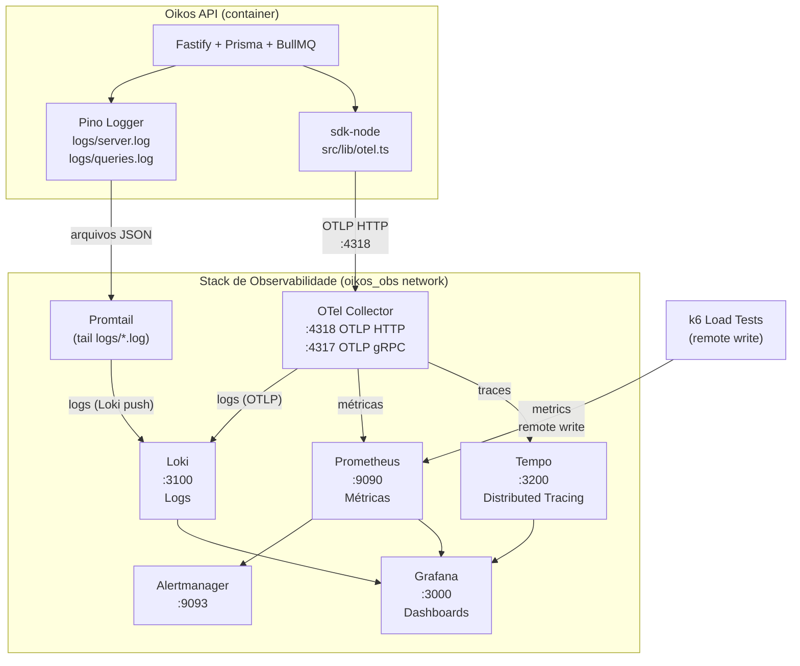

# Oikos DevOps

Infraestrutura de observabilidade e testes de carga para a Oikos API.

---

## Estrutura

```
devops/
├── observability/      Stack Grafana (OTel Collector, Prometheus, Loki, Tempo, Grafana)
└── load-tests/         Scripts k6 (smoke, load, stress, spike, soak)
```

---

## Arquitetura de observabilidade



**Como os logs chegam ao Loki:**
O Pino já grava JSON estruturado em `logs/server.log` e `logs/queries.log` (arquivos físicos na raiz do projeto). O Promtail faz tail desses arquivos via bind mount (`../../logs:/var/log/oikos:ro`), extrai labels (`level`, `traceId`, `spanId`) via pipeline JSON, e envia ao Loki. Nenhuma mudança no `logger.ts` é necessária para o log pipeline — o `mixin` OTel apenas enriquece cada registro com os campos de rastreamento.

---

## Startup — sequência completa

### 1. Criar o arquivo de env da stack de observabilidade

```bash
cp devops/observability/.env.observability.example devops/observability/.env.observability
# edite o arquivo se quiser trocar a senha do Grafana ou configurar Slack
```

### 2. Criar a rede bridge compartilhada (apenas uma vez)

```bash
docker network create oikos_obs
```

### 3. Subir a stack de observabilidade

```bash
docker compose -f devops/observability/docker-compose.observability.yml up -d
```

Aguarde todos os serviços ficarem `healthy`. Verifique:

```bash
docker compose -f devops/observability/docker-compose.observability.yml ps
```

### 4. Subir a API

```bash
docker compose -f docker-compose.prod.yml up -d
```

O `docker-compose.prod.yml` já inclui a rede `oikos_obs` e lê `OTEL_EXPORTER_OTLP_ENDPOINT` do `.env.prod`.
### 5. Verificar instrumentação

```bash
curl localhost:3333/v1/waste-categories
```

Abra o Grafana em [http://localhost:3000](http://localhost:3000) e acesse:
- **Explore → Tempo**: deve aparecer um span para `/v1/waste-categories`
- **Explore → Loki** (`{job="oikos-server"}`): logs com campo `traceId`
- **Explore → Prometheus** (`oikos_http_server_request_duration_seconds_count`): série visível

---

## URLs locais

| Serviço | URL | Credenciais |
|---|---|---|
| Grafana | http://localhost:3000 | admin / admin (padrão) |
| Prometheus | http://localhost:9090 | — |
| Tempo | http://localhost:3200 | — |
| Loki | http://localhost:3100 | — |
| Alertmanager | http://localhost:9093 | — |
| OTel Collector health | http://localhost:13133 | — |

---

## Env vars por cenário

| Cenário | `OTEL_EXPORTER_OTLP_ENDPOINT` |
|---|---|
| Produção com obs stack | `http://otelcol:4318` (default no `.env.prod.example`) |
| Produção sem obs stack | _(deixar em branco — OTel SDK é no-op)_ |
| CI smoke test | _(não necessário — k6 sem remote write)_ |

---

## Como adicionar um novo dashboard

1. Crie ou exporte o dashboard no Grafana (⚙️ → Export → Export for sharing externally)
2. Salve o JSON em `devops/observability/grafana/dashboards/<nome>.json`
3. Reinicie o Grafana (ou aguarde o `updateIntervalSeconds: 30` do provider):

```bash
docker compose -f devops/observability/docker-compose.observability.yml restart grafana
```

---

## Orçamento de recursos dos serviços

| Serviço | Limite de memória |
|---|---|
| OTel Collector | 256 MB |
| Prometheus | 512 MB |
| Loki | 256 MB |
| Tempo | 256 MB |
| Promtail | 64 MB |
| Grafana | 256 MB |
| Alertmanager | 64 MB |
| **Total** | **~1.7 GB** |

A stack de observabilidade deve rodar em uma máquina separada da API (ex: t3.medium local ou instância dedicada). Nunca incluir no `docker-compose.prod.yml`.

---

## Testes de carga (k6)

Ver `devops/load-tests/README.md` para comandos completos.

**Smoke rápido (sem Prometheus):**

```bash
docker run --rm --network=host \
  -e BASE_URL=http://localhost:3333 \
  -v "$(pwd)/devops/load-tests:/scripts" \
  grafana/k6:latest run /scripts/smoke.js
```

**Com dashboard em tempo real:**

```bash
docker run --rm --network=host \
  -e BASE_URL=http://localhost:3333 \
  -e K6_PROMETHEUS_RW_SERVER_URL=http://localhost:9090/api/v1/write \
  -e K6_TEST_NAME=load \
  -v "$(pwd)/devops/load-tests:/scripts" \
  grafana/k6:latest run --out=experimental-prometheus-rw /scripts/load.js
```

Dashboard: [http://localhost:3000/d/oikos-k6](http://localhost:3000/d/oikos-k6)

---

## Alertmanager

Os alertas estão em stub (receiver `null`) por padrão. Para habilitar Slack:

1. Copie `.env.observability.example` para `.env.observability`
2. Preencha `ALERTMANAGER_SLACK_WEBHOOK_URL`
3. Descomente a config no `alertmanager/alertmanager.yml`
4. Adicione regras de alerta no `prometheus/prometheus.yml` (seção `rule_files`)

---

## Desligar a stack

```bash
docker compose -f devops/observability/docker-compose.observability.yml down
# Para remover volumes (dados permanentes):
docker compose -f devops/observability/docker-compose.observability.yml down -v
```
