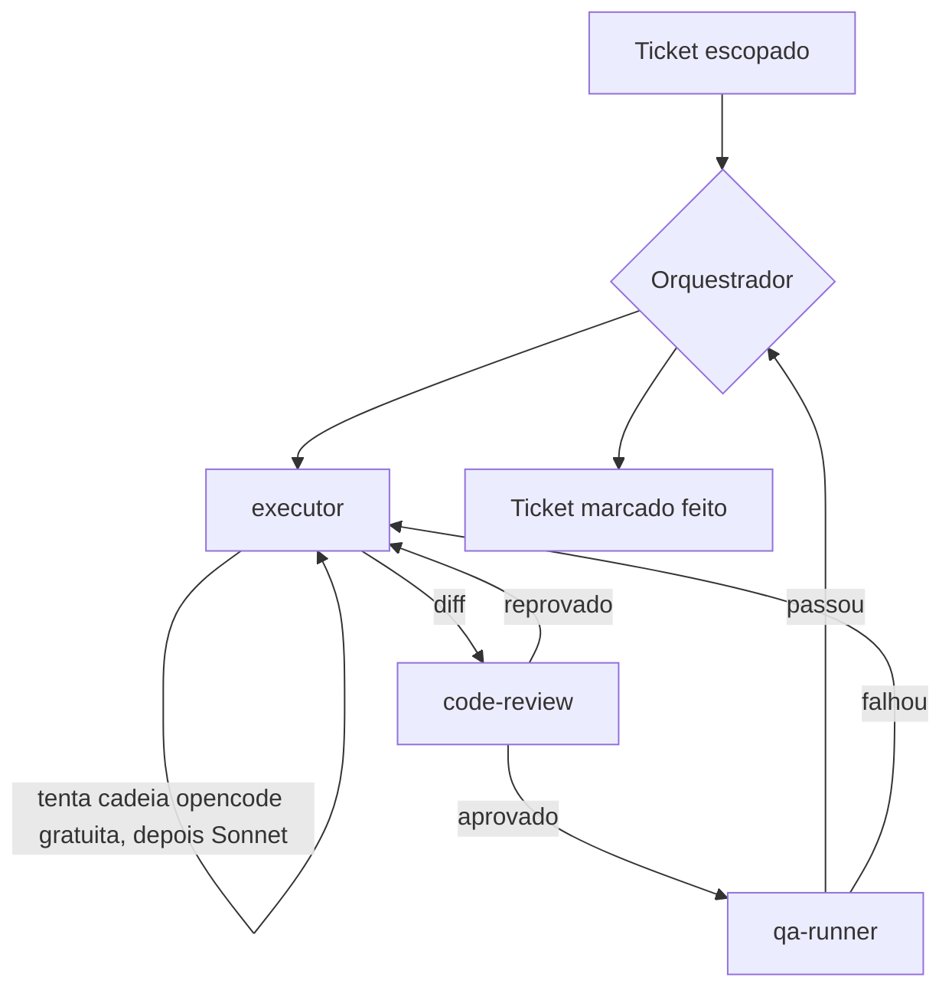

# Subagents nativos do Claude Code

Terceira peça do sistema de orquestração deste repo, complementar às outras duas — não substitui
nenhuma:

- **`00-modelo-de-orquestracao.md`** — `orca-ide` despachando pra terminais/worktrees separados por
  task, protocolo `dispatch`/`worker_done`. Bom pra épico multi-task, isolado do checkout
  principal, com escalonamento de tier auditável.
- **`.opencode/prompt/{oikos-exec,oikos-review,oikos-text}.md`** — customização por-repo da MESMA
  cadeia global de modelos OpenCode que o item acima despacha, e que o `executor` abaixo também
  reaproveita via `Bash`.
- **Este documento** — subagents chamados via tool `Agent` do próprio Claude Code, dentro da MESMA
  sessão, sem terminal/worktree separado. Réplica direta do padrão já implementado e documentado em
  `mobile/.claude/agents/*.md` + `mobile/docs/agent-architecture.md`, adaptada ao stack desta API
  (Fastify/Zod/Prisma/vitest).

## Quando usar qual

| Situação | Mecanismo |
|---|---|
| Ticket único, escopado, dentro da sessão atual (ex.: um ticket de `plans/*/tickets/`) | Subagent Claude nativo (este doc) |
| Épico com várias tasks, quer rodar isolado do checkout principal / em paralelo | `orca-ide` (`00-modelo-de-orquestracao.md`) |
| Typo, fix de uma linha com causa óbvia, pergunta factual | Nenhum — a sessão principal resolve direto |

## Roster

| Agent | Papel | `tools` | `model` |
|---|---|---|---|
| `executor` | Implementa UM ticket (entities/DTOs/repositórios/use-cases/rotas), tenta a cadeia OpenCode gratuita antes de escrever ele mesmo | `Read, Grep, Glob, Edit, Write, Bash, Skill` | `sonnet` |
| `code-review` | Gate obrigatório, só leitura, roda depois de qualquer saída do `executor` | `Read, Grep, Glob, Bash, Skill` | `sonnet` |
| `qa-runner` | Roda a suíte de integração/e2e e/ou bate na rota de verdade, reporta pass/fail | `Read, Grep, Bash, Skill` | `haiku` |

Nenhum dos três tem a tool `Agent` — só o orquestrador (a sessão principal) encadeia agents, mesma
regra de `mobile`. Conteúdo real em `.claude/agents/{executor,code-review,qa-runner}.md` — não
duplicado aqui.

## Protocolo

O orquestrador nunca escreve o diff de um ticket ele mesmo, exceto como último recurso (mesma regra
de `00-modelo-de-orquestracao.md`) — e nunca marca ticket como concluído sem passar por
`code-review` e, quando o ticket mexe em rota/DB, `qa-runner`.

## Deliberadamente fora desta rodada

Sem equivalente a `performance-executor`/`release-executor`/`observability-analyst` de `mobile` —
nenhum tem uso concreto hoje neste repo (sem epic de performance ou observabilidade em andamento,
sem processo de release análogo a app store). Criar um agent por "completude" antes de haver
necessidade real é o próprio anti-padrão que a revisão de 2026-08-27 de `mobile` corrigiu (13→6
agents lá). Se/quando surgir um caso concreto, criar o agent então.

## Status

**Implementado, não validado numa task real ainda.** Os 3 arquivos existem e seguem o formato de
`mobile`, mas o roteiro completo (executor tenta cadeia opencode → code-review → qa-runner →
orquestrador aceita) ainda não rodou ponta a ponta neste repo. Próximo passo real: usar em um
ticket de verdade (ex.: um dos tickets de `plans/moderation/tickets/`) e registrar aqui o que
funcionou/quebrou — mesma prática de honestidade que `mobile/docs/agent-architecture.md` usa (ver
seção 8 de lá).

## Nota sobre nomenclatura dos tiers OpenCode

Os nomes de preset citados em `executor.md` (`opencode-big-pickle`, `opencode-muse-spark-1.2`,
`opencode-mimo-v2.5`, `opencode-hy3`, `omniroute-omini-free-tier`, `opencode-go-kimi-k2.7`) são os
atuais em `~/.config/opencode/opencode.json` — **diferentes** dos nomes ainda listados em
`00-modelo-de-orquestracao.md` (`oikos-exec`, `oikos-exec-gemini`, `oikos-exec-alt`,
`oikos-exec-go`). A renomeação (`provedor-modelo` em vez de aliases genéricos) aconteceu
globalmente em 2026-08-27 — registrada em `mobile/docs/agent-architecture.md` §9, nunca refletida
na doc de `api`. `oikos-exec-gemini` em particular foi removido por completo da config global
(instável — cota compartilhada, travava no meio da task).
