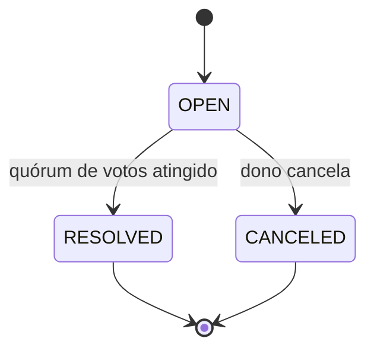
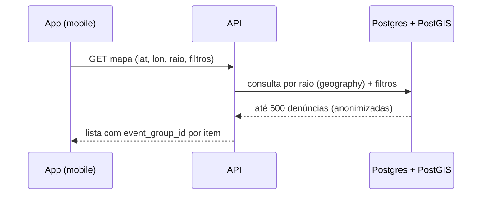
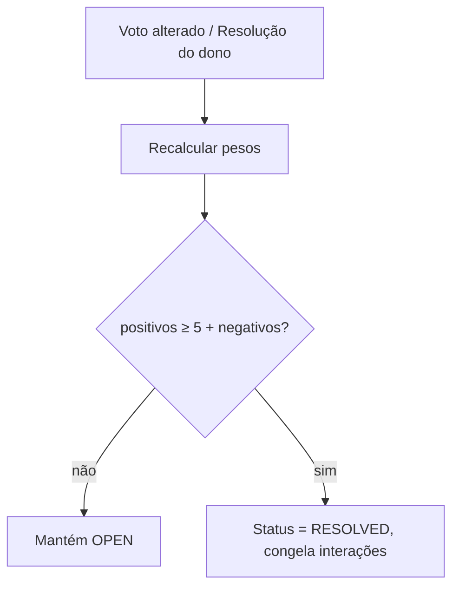

# Core Flows — Denúncias Colaborativas
## Atores

- **Dono da denúncia** — usuário autenticado que criou a denúncia.
- **Cidadão consumidor** — qualquer usuário autenticado da plataforma, navegando o mapa público ou interagindo com denúncias de terceiros.
- **Sistema** — processadores assíncronos (agrupamento por proximidade, fechamento por quórum).

## Estados de uma denúncia (escopo deste Epic)



`IN_PROGRESS` e `REJECTED` permanecem no enum por compatibilidade, mas **não são produzidos nem consumidos** por nenhum fluxo deste Epic. `RESOLVED` e `CANCELED` são **terminais**: congelam votos, resoluções e removem a denúncia do mapa público (filtro default).

---

## Flow 1 — Registrar denúncia automática (captura ao vivo)

- **Quem:** Dono da denúncia, com o app no local do evento.
- **Entrada:** Câmera do app aberta a partir do botão de "nova denúncia".
- **Passos:**
  1. Dono escolhe o tipo da denúncia e captura **uma ou mais fotos/vídeos** no momento.
  2. Para cada captura, o app coleta automaticamente o `geospatial` completo (heading, location, addresses) via GPS.
  3. Dono confirma e envia.
  4. Sistema cria a denúncia (método = automático), com **uma captura por mídia**, **cada captura com exatamente 1 anexo**.
  5. Sistema responde com a denúncia criada e dispara em background o agrupamento por proximidade.
- **Saída:** Dono vê confirmação e a denúncia aparece em "minhas denúncias" como `OPEN`.

## Flow 2 — Registrar denúncia manual (upload posterior)

- **Quem:** Dono da denúncia, em qualquer momento posterior ao evento.
- **Entrada:** Ação "registrar manualmente" no app.
- **Passos:**
  1. Dono escolhe o tipo da denúncia, informa **observações** (opcional) e a **data/hora** do evento.
  2. Dono **informa o endereço** (obrigatórios: cidade, bairro, rua, número, CEP, estado) e a localização no mapa (lat/lon obrigatórios). `heading` fica nulo.
  3. Dono anexa **múltiplas imagens/vídeos** já existentes no dispositivo (todos pertencem a uma única captura manual).
  4. Sistema cria a denúncia (método = manual), com **uma captura agregando todos os anexos**; cada anexo pode opcionalmente trazer metadados extras (EXIF/device/etc).
  5. Sistema responde com a denúncia criada e dispara em background o agrupamento por proximidade.
- **Saída:** Dono vê confirmação e a denúncia aparece em "minhas denúncias" como `OPEN`.

## Flow 3 — Consultar minhas denúncias / detalhe da minha denúncia

- **Quem:** Dono da denúncia.
- **Entrada:** Aba "minhas denúncias" ou link direto.
- **Passos:**
  1. Dono lista as próprias denúncias paginadas, com filtros por `type` e `status`.
  2. Dono abre uma denúncia e vê: capturas com anexos, status, contagem de votos positivos/negativos, lista de resoluções submetidas (anônimas) e sua própria resolução (se houver).
- **Saída:** Dono pode disparar os fluxos 4, 5 ou 7 a partir do detalhe.

## Flow 4 — Cancelar denúncia (dono)

- **Quem:** Dono da denúncia.
- **Entrada:** Ação "cancelar" no detalhe da própria denúncia.
- **Passos:**
  1. Dono confirma o cancelamento.
  2. Sistema altera status para `CANCELED` (estado terminal).
  3. Votos e resoluções existentes permanecem como histórico, mas **novos votos/resoluções são rejeitados**.
  4. A denúncia some do mapa público (filtro default).
- **Saída:** Dono vê a denúncia como `CANCELED` em "minhas denúncias".

## Flow 5 — Dono marca como resolvido (com resolução obrigatória)

- **Quem:** Dono da denúncia.
- **Entrada:** Ação "marcar como resolvido" no detalhe da própria denúncia.
- **Passos:**
  1. Dono preenche a **resolução estruturada**: descrição, quem resolveu (texto livre), nota 1–5 e anexos opcionais.
  2. Dono confirma.
  3. Sistema registra **simultaneamente**: (a) a resolução do dono e (b) um voto positivo do dono com **peso 2**.
  4. Sistema reavalia o quórum (ver Flow 11). Se atingido, a denúncia vai para `RESOLVED` imediatamente; caso contrário permanece `OPEN`.
- **Saída:** Dono vê o estado atualizado e a contagem de votos refletida.

## Flow 6 — Votar em denúncia de terceiro

- **Quem:** Cidadão consumidor (≠ dono).
- **Entrada:** Detalhe público de uma denúncia (acessado pelo mapa ou link).
- **Passos:**
  1. Cidadão escolhe **votar como `RESOLVED`** ou **votar como `NOT_RESOLVED`**.
  2. Sistema registra o voto (peso 1). Cada cidadão tem **um único voto por denúncia**.
  3. Cidadão pode **alternar** entre `RESOLVED` / `NOT_RESOLVED` ou **remover** o voto enquanto a denúncia não estiver `RESOLVED`.
  4. Sistema reavalia o quórum a cada mudança de voto (síncrono ou via job — ver Flow 11).
- **Saída:** Cidadão vê a contagem agregada atualizada e seu voto atual destacado.

> **Observação:** o dono também pode usar este fluxo para votar `NOT_RESOLVED` (peso 2) na própria denúncia — útil para barrar resoluções confirmadas por terceiros que ele considera inválidas.

## Flow 7 — Submeter / editar resolução (qualquer usuário)

- **Quem:** Qualquer usuário autenticado.
- **Entrada:** Ação "anexar resolução" no detalhe da denúncia.
- **Passos:**
  1. Usuário preenche descrição, quem resolveu (texto livre), nota 1–5 e anexos opcionais.
  2. Se ainda **não submeteu** uma resolução nesta denúncia, sistema a cria.
  3. Se **já submeteu**, sistema atualiza a sua resolução (edição é permitida enquanto `OPEN`).
  4. Não há ação de deletar resolução.
- **Saída:** Resolução aparece na lista agregada da denúncia (anônima para todos).

## Flow 8 — Explorar denúncias no mapa público

- **Quem:** Cidadão consumidor.
- **Entrada:** Abertura do mapa no app, com a posição atual do dispositivo.
- **Passos:**
  1. App envia centro (`lat`, `lon`) e `raio` em metros, mais filtros opcionais (`type[]`, `status[]`, intervalo de `created_at`).
  2. Sistema retorna até **500 denúncias individuais**, cada uma com: ponto, tipo, status, contagem de votos, número de resoluções, `event_group_id` e capturas/anexos resumidos. **Sem identidade do autor.**
  3. Default: apenas denúncias `OPEN`.
  4. Cliente decide se renderiza pontos individuais ou agrupa visualmente pelo `event_group_id`.
- **Saída:** Cidadão visualiza denúncias da região e pode tocar em qualquer ponto para abrir o Flow 9.



## Flow 9 — Ver detalhe público de uma denúncia (anônimo)

- **Quem:** Qualquer usuário autenticado.
- **Entrada:** Toque em um pin do mapa ou link direto.
- **Passos:**
  1. Sistema retorna: capturas, anexos, status, contagem de votos positivos/negativos, lista de resoluções (anônimas).
  2. Identidade do criador, dos votantes e dos resolvedores **nunca é exposta**.
  3. A partir daqui o usuário pode disparar Flow 6 (votar) ou Flow 7 (submeter resolução).
- **Saída:** Usuário tem contexto suficiente para decidir como interagir.

## Flow 10 — Sistema: agrupar por proximidade (background)

- **Quem:** Sistema (worker assíncrono).
- **Gatilho:** Criação de uma nova denúncia (Flows 1 e 2).
- **Passos:**
  1. Worker recebe o evento de "nova denúncia".
  2. Busca denúncias **não terminais** (`OPEN`) no raio de **15m**, com o **mesmo `type`**.
  3. Se encontrar alguma, atribui o **mesmo `event_group_id`** à nova denúncia.
  4. Se não encontrar, gera um novo `event_group_id` exclusivo para ela.
- **Saída:** A denúncia passa a aparecer agrupada nos próximos acessos ao mapa. Eventual consistência: o cliente pode pegar a denúncia sem `event_group_id` por alguns segundos.

## Flow 11 — Sistema: fechar denúncia por quórum (background)

- **Quem:** Sistema (worker assíncrono).
- **Gatilho:** Qualquer mudança de voto ou submissão de resolução do dono (Flows 5 e 6).
- **Regra:** soma de `pesos positivos` ≥ `5 + soma de pesos negativos` ⇒ status vai para `RESOLVED`.
  - Pesos: dono = 2, terceiros = 1.
  - Negativos do dono também pesam 2 e bloqueiam o fechamento.
- **Passos:**
  1. Worker recalcula `pesos_positivos` e `pesos_negativos` da denúncia.
  2. Se a regra for satisfeita e a denúncia ainda for `OPEN`, transiciona para `RESOLVED` (estado terminal).
  3. A partir daí, novos votos/resoluções são rejeitados e a denúncia some do mapa público (filtro default).
- **Saída:** Próximos acessos veem a denúncia como `RESOLVED`; dono e participantes podem consultá-la em "minhas denúncias" / detalhe direto.



## Fora de escopo (deixado explícito)

- Comentários/fórum, "me todo" e qualquer interação textual entre cidadãos.
- Confiabilidade de perfis e empresas (Epic separado).
- Transição para `IN_PROGRESS` e fluxo de `REJECTED` (moderação).
- Exposição de identidade dos votantes/resolvedores.
- UI mobile do mapa, filtros visuais e clustering visual.

---

## Fluxo de Execução

Ordem de implementação baseada em dependências técnicas e valor incremental. Cada fase só inicia após a anterior estar com testes passando.

### Fase 0 — Empresas (pré-requisito do resolver)

> Deve ser concluída antes da Fase 5. `ComplaintResolution.resolver_user_id` deriva de `User → Company`; o resolver público exige `description` e avatar de `Company`.

| # | Tarefa | Arquivos principais |
|---|---|---|
| 0.1 | Schema: relação `User → Company` vira 1:N (remove `@unique` de `company.user_id`); adiciona `description String?` + novo model `CompanyAvatar` com `avatar_id String?` em `Company` | `prisma/schema.prisma` |
| 0.2 | Migration aditiva | `prisma/migrations/` |
| 0.3 | DTO: `business_name` obrigatório quando `identity_type = CPF` via `.superRefine` | `src/modules/companies/dtos/companies-dto.ts` |
| 0.4 | Repositório: `findByUserId` retorna array; adiciona `findByUserAndCompanyId` para operações de escrita | `repositories/companies-repository.ts` + impls |
| 0.5 | Use-cases: remove guard de empresa única; todas as escritas verificam `company_id ∈ user` | todos use-cases de companies |
| 0.6 | Novo use-case `upload-company-avatar` + spec + rota `POST /companies/:id/avatar` | `use-cases/` + `company-routes.ts` |

---

### Fase 1 — Schema e Infra (fundação)

| # | Tarefa | Arquivos principais |
|---|---|---|
| 1.1 | Enums: `ComplaintMethod { AUTOMATIC, MANUAL }` e `ComplaintVoteType { RESOLVED, NOT_RESOLVED }` | `prisma/enums.prisma` |
| 1.2 | Schema: novos models `Complaint` (agregado raiz com `complaint_method`, `event_group_id`, `location geography(Point,4326)`), `ComplaintCapture`, `ComplaintVote`, `ComplaintResolution` (com `resolver_user_id`); atualiza `ComplaintAttachment` com `metadata Json?` | `prisma/schema.prisma` |
| 1.3 | Índice GiST em `Complaint.location` | `prisma/schema.prisma` |
| 1.4 | Migration aditiva (preserva dados existentes) | `prisma/migrations/` |
| 1.5 | Setup BullMQ + Redis: client, fila base, sem workers ainda | `src/lib/queue/` |

---

### Fase 2 — Refactor core do módulo complaints

> Preserva contratos externos dos endpoints enquanto adapta a hierarquia interna `Complaint → ComplaintCapture → ComplaintAttachment`.

| # | Tarefa | Arquivos principais |
|---|---|---|
| 2.1 | DTOs: novos schemas `ComplaintCapture`, `ComplaintVote`, `ComplaintResolution`; `geospatialManualSchema` (heading nullable, addresses obrigatórios); `resolverSchema` polimórfico (`{ type: "company" } \| { type: "profile" }`) | `dtos/complaints-dto.ts` |
| 2.2 | Interface do repositório: novos métodos para votos, resoluções e consulta por raio | `repositories/complaints-repository.ts` |
| 2.3 | In-memory: atualizar implementação completa | `repositories/in-memory/` |
| 2.4 | Prisma: atualizar implementação (novo modelo hierárquico) | `repositories/prisma/` |
| 2.5 | Refatorar use-cases existentes: `create`, `get`, `getMany`, `update`, `cancel` | `use-cases/` |
| 2.6 | Atualizar rotas existentes sem quebrar contratos | `complaint-routes.ts` |

---

### Fase 3 — Criação de denúncias (Flows 1 e 2)

| # | Tarefa | Arquivos principais |
|---|---|---|
| 3.1 | Use-case `create-complaint-automatic` + spec; ao final dispara job de agrupamento | `use-cases/create-complaint-automatic-use-case.ts` |
| 3.2 | Use-case `create-complaint-manual` + spec; valida `geospatialManualSchema` (lat/lon + address obrigatórios, heading null) | `use-cases/create-complaint-manual-use-case.ts` |
| 3.3 | Rotas: `POST /complaints` (automático) + `POST /complaints/manual` | `complaint-routes.ts` |

---

### Fase 4 — Acesso público (Flows 8 e 9)

| # | Tarefa | Arquivos principais |
|---|---|---|
| 4.1 | Repositório Prisma: query `ST_DWithin` com filtros opcionais (`type`, `status`, intervalo de data) e limite 500 | `repositories/prisma/` |
| 4.2 | Use-case `get-map-complaints` + spec de integração com Postgres+PostGIS real | `use-cases/get-map-complaints-use-case.ts` |
| 4.3 | Use-case `get-public-complaint` + spec; popula `resolver` lendo `User → Company` (se existir) ou `User → Profile` (fallback) | `use-cases/get-public-complaint-use-case.ts` |
| 4.4 | Rotas: `GET /complaints/map` (autenticado) + `GET /complaints/:id/public` | `complaint-routes.ts` |

---

### Fase 5 — Votação e resolução (Flows 5, 6 e 7)

> Depende da **Fase 0** estar concluída: `Company.description` e `CompanyAvatar` precisam existir para popular o resolver público.

| # | Tarefa | Arquivos principais |
|---|---|---|
| 5.1 | Use-case `vote-complaint` + spec: 1 voto por user por denúncia, alternável/removível enquanto `OPEN`; peso dono=2 / terceiro=1; dispara job de quórum | `use-cases/vote-complaint-use-case.ts` |
| 5.2 | Use-case `submit-resolution` + spec: cria ou atualiza resolução; `resolver_user_id` = userId do request (sem campo livre); editável enquanto `OPEN` | `use-cases/submit-resolution-use-case.ts` |
| 5.3 | Atualizar semântica de `PATCH /complaints/:id/resolved`: registra voto peso-2 do dono + exige resolução estruturada no mesmo request | `use-cases/resolve-complaint-use-case.ts` + rota |
| 5.4 | Rotas: `POST /complaints/:id/votes`, `DELETE /complaints/:id/votes`, `POST /complaints/:id/resolutions`, `PATCH /complaints/:id/resolutions` | `complaint-routes.ts` |

---

### Fase 6 — Workers assíncronos (Flows 10 e 11)

| # | Tarefa | Arquivos principais |
|---|---|---|
| 6.1 | Worker `group-complaints`: busca denúncias `OPEN` no raio de 15m com mesmo `type`; atribui `event_group_id` existente ou gera novo | `workers/group-complaints-worker.ts` |
| 6.2 | Worker `resolve-by-quorum`: recalcula `pesos_positivos` e `pesos_negativos`; se `positivos ≥ 5 + negativos` → status `RESOLVED` (terminal) | `workers/resolve-by-quorum-worker.ts` |
| 6.3 | Registrar workers no bootstrap da aplicação | `src/app.ts` |

---

### Fase 7 — Testes e integração

| # | Tarefa |
|---|---|
| 7.1 | Unitários por use-case com repositórios in-memory (Fases 2–5) |
| 7.2 | Integração: `get-map-complaints` com Postgres+PostGIS real |
| 7.3 | Integração: fluxo completo de quórum (vote → worker → status `RESOLVED`) |

---

### Mapa de dependências

```
Fase 0 ────────────────────────────────────────────┐
                                                    │
Fase 1 ──► Fase 2 ──► Fase 3                       │
                  │                                 │
                  └──► Fase 4                       │
                  │                                 ▼
                  └──► Fase 5 ◄──────────── (resolver identity)
                           │
                           └──► Fase 6
                                   │
Todas ──────────────────────────── └──► Fase 7
```

